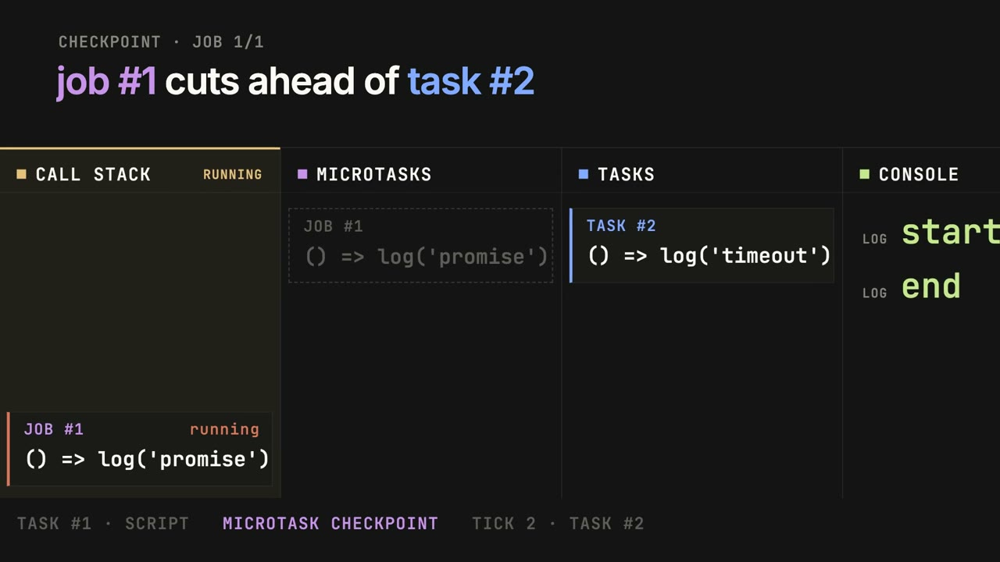

<p align="center">
  <picture>
    <source media="(prefers-color-scheme: dark)" srcset="docs/assets/logo/logo-symbol-color-dark-bg.svg">
    
  </picture>
</p>

# Event Loop Visualizer

Paste a JavaScript Script, press Run, and replay every step of the Run against a simulated browser
event loop: call stack, microtask queue, task queue, timers, Virtual Clock and console.

The Observable Output of a Run (console lines, uncaught exceptions, unhandled rejections) matches
what Chrome 155 produces for the same Script. Differential tests check this: they run each fixture
in real Chrome and in the simulator and compare the two outputs. The app
targets one Host Profile, `chrome-155`.

The site is not deployed yet. The maintainer deploys by hand with
[docs/deployment-guide.md](docs/deployment-guide.md) and will add the URL here.

## Showreel

[](docs/assets/showreel/event-loop-showreel.mp4)

A 15-second motion piece made from the app's sample Script (click the frame to play it, sound
on). It is rendered in code from [`motion/`](motion/): `node score.mjs` synthesizes the score and
measures its beat grid, then `node render.mjs` renders every frame through `window.seek(t)` and
encodes the MP4.

## How it works

The Script runs in [engine262](https://github.com/engine262/engine262) behind a hand-written HTML
event-loop host on a Virtual Clock, inside a Web Worker. A Run produces one immutable Trace. The UI
never drives the engine: it replays the Trace (play/pause, step, jump by Tick or Task, scrubber,
source highlighting). Callback chips (the code a Task or Job will call) move between the panels as the replay steps. Three views show the same state: labelled Panels (default), an animated
Diagram, and the isometric 3D Scene. The UI is in English and Vietnamese. "Ask AI" (the ASK AI button
at the end of the playback dock) lets a learner ask their own OpenRouter model to walk through the
whole Run as a tour: Next and Previous move the replay to each stop. The browser sends the key
straight to OpenRouter and the app stores it nowhere unless the learner asks it to remember the key on that
device. Architecture: [docs/system-architecture.md](docs/system-architecture.md).
Status and plans: [docs/project-roadmap.md](docs/project-roadmap.md). Terms are defined in
[GLOSSARY.md](GLOSSARY.md). The code is the record of design decisions.

## Logo

The mark is a square loop. Its top-right corner has broken off as a block: the Task running now.
The block uses the app's orange accent, which in the UI always means "now". The masters live in
[docs/assets/logo/](docs/assets/logo/): black, white, colour on light and on dark, and a dark tile.
`logo-tile-small.svg` is a 16px-grid cut with wider gaps, used for `public/favicon.svg` and
`public/favicon.ico`.

## Supported APIs

- Everything engine262 implements: Promise, async/await, generators, async generators, `for await`.
- `setTimeout`, `setInterval`, `clearTimeout`, `clearInterval`
- `queueMicrotask`
- `MessageChannel`, `port.postMessage`, `port.onmessage`, `port.start()`, `port.close()`
- `console.log`, `console.info`, `console.warn`, `console.error`
- `Date.now()` and `performance.now()` (they read the Virtual Clock)
- Scripts run as classic scripts. `Math.random` is seeded per Run.

## Unsupported APIs

`fetch`, the DOM (`document`, `window`), `requestAnimationFrame`, `window.postMessage`,
`addEventListener` (including `addEventListener('message')`), `MessagePort` transfer, modules and
`import`, `FinalizationRegistry`, `WeakRef`, `Atomics.wait`, `SharedArrayBuffer`.

Each one is a stub that throws `UnsupportedApiError` with the API's name, and a scan lists the ones
a Script uses before it runs. The app does not guess how they would be ordered. `requestAnimationFrame` is the first
candidate for v1.1 (see the roadmap).

## Prerequisites

- Node.js `^22.18.0 || >=24.12.0` (CI uses 24)
- pnpm 12.14.0, pinned by `packageManager` in `package.json`. Install it globally or run
  `corepack pnpm`. A global pnpm 10 cannot switch itself to 12. Do not use npm or yarn: pnpm
  manages the lockfile, the engine262 pin and the engine262 patch, which it reapplies
  on every install.
- `pnpm-workspace.yaml` sets `minimumReleaseAge: 1440`, so pnpm only resolves versions published at
  least a day ago, and the lockfile must not contain newer ones.

## Run it

```sh
pnpm install --frozen-lockfile
pnpm dev                # http://localhost:5173
```

## Tests and checks

```sh
pnpm run type-check     # vue-tsc
pnpm exec vitest run    # unit tests (watch mode: pnpm test:unit)
pnpm run test:oracle    # differential fixtures vs recorded Chrome 155 goldens
pnpm run build-only && pnpm run check:build   # production build + build gate
pnpm exec playwright install                  # once, to download e2e browsers
pnpm test:e2e           # Playwright e2e (dev server on :5173; CI serves the built app on :4173)
```

- `pnpm run lint` runs `oxlint --fix` and `eslint --fix`, which can rewrite files, including the
  oracle fixtures. Check `git status` afterwards. CI runs `pnpm exec oxlint .` and
  `pnpm exec eslint .` without `--fix`.
- `test:oracle` needs no browser: it runs each fixture in the simulator and compares it with the
  committed `oracle/fixtures/*.golden.json`. `.github/oracle-known-failures.txt` lists the fixtures
  expected to fail until their behavior lands; CI fails on any other failure.
- `check:build` asserts that engine262 is only in the Worker chunk and that built-in function names
  survive minification (they become frame labels in the Trace).

## Re-record the oracle goldens

You only need this when you add a fixture or move to a new Chrome major. It needs a local Google
Chrome whose major version is exactly 155; the recorder refuses to run with any other version (add
a new Host Profile first).

```sh
pnpm oracle:record                  # all fixtures
pnpm oracle:record <fixture-name>   # one fixture, e.g. queue-microtask-vs-then
```

The recorder runs each fixture 5 times in Chrome. If the runs disagree, the fixture is
non-deterministic.
A `// @oracle-skip: <reason>` line at the top of a fixture marks a Skipped Fixture.

## CI

`.github/workflows/ci.yml` runs on every pull request and on pushes to `main` and `integration/v1`:

- `checks`: oxlint, eslint, type-check, unit tests
- `oracle`: `test:oracle`, gated on unexpected fixture failures
- `e2e`: installs Playwright browsers, runs `build-only`, the `check:build` gate, then Playwright
